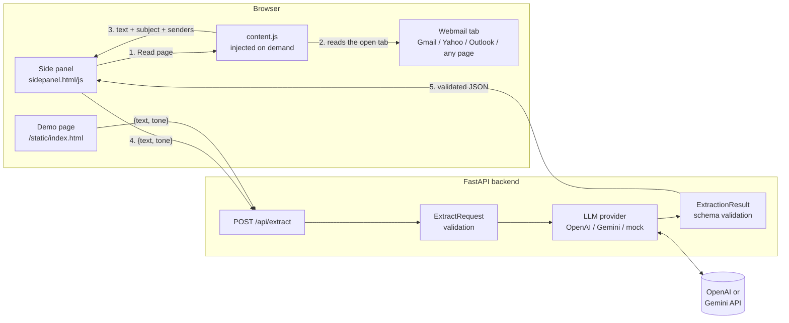

# AI Email & Message Action-Item Extractor

Turn a long email or a messy group thread into a short list of **what you need to do**, **by when**, **what you need to answer**, and a **ready-to-edit reply**, without leaving the tab you're on.

The project has three parts:

- **Chrome extension (Manifest V3 side panel).** Open it next to Gmail, Yahoo Mail, Outlook, or any web page. One click reads the open email (or your highlighted text) and shows the results beside it.
- **FastAPI backend.** Sends the text to an LLM (OpenAI or Google Gemini) and checks that the response matches a strict Pydantic schema before returning it.
- **Web demo page.** A single-page tester served by the backend, so anyone can try the API in a browser without installing the extension.

## What you get back

| Field | Description |
|---|---|
| **Priority** | `HIGH` / `MEDIUM` / `LOW`, plus a one-sentence reason |
| **Group thread?** | Whether it's a multi-person thread or a 1-on-1 message |
| **Action items** | Each task with an **owner** (a name, `You`, or `Unassigned`) and a **deadline** as written in the message (or `No hard deadline`) |
| **Questions to answer** | Direct and implied questions *you* need to reply to. Questions aimed at someone else in a group thread are left out. |
| **Draft reply** | A reply in your chosen tone (`Professional`, `Casual`, `Direct`) that uses **bracketed placeholders** such as `[Insert Available Times]` or `[Confirm Yes/No]` wherever the answer isn't in the message |

The reply never invents facts or answers for you. If the email asks "are you free Thursday?", the draft says `Thursday afternoon [works / doesn't work] for me`, not "Yes, I'm free". The live tests check for this (see [Testing](#testing)).

---

## Architecture



**Request flow**

1. The user clicks **Read Current Page / Selection** in the side panel.
2. The panel injects `content.js` into the active tab with `chrome.scripting.executeScript`. The script returns, in this order of preference:
   - the highlighted text,
   - the open email thread (with `From:`, `To:`, and `Date:` for each message, which helps the model detect group threads),
   - the page's main `<article>` / `<main>` content.
3. The panel sends `{ text, tone }` to `POST /api/extract`.
4. The backend validates the input, builds the prompt, and calls the configured provider:
   - **Gemini** receives the Pydantic model directly as `response_schema`.
   - **OpenAI** runs in JSON mode with the JSON Schema included in the system prompt.
5. The raw model output is parsed into `ExtractionResult` with `extra="forbid"`, strict enums, and non-blank fields. Output that doesn't match becomes an HTTP `502` instead of reaching the UI.

### Repository layout

```
ai-email-extractor/
├── backend/
│   ├── main.py              # FastAPI app, CORS, routes, static mount
│   ├── schemas.py           # Pydantic request/response models (single source of truth)
│   ├── ai_service.py        # Prompt + OpenAI / Gemini / mock providers
│   ├── static/index.html    # Web demo page (no build step)
│   ├── samples/             # Messy group email + dense 1-on-1 paragraph
│   ├── tests/               # Offline API/schema tests + opt-in live LLM tests
│   ├── requirements.txt
│   ├── requirements-dev.txt
│   └── .env.example
├── extension/
│   ├── manifest.json        # MV3: sidePanel, activeTab, scripting, storage
│   ├── background.js        # Opens the side panel on toolbar click
│   ├── content.js           # Page/email text extractor (injected on demand)
│   ├── sidepanel.html/.css/.js
│   └── icons/
└── README.md
```

---

## Setup

### Prerequisites

- **Python 3.11+** (developed and tested on 3.14)
- **Google Chrome 116+** (for the extension)
- An API key for **one** of:
  - **OpenAI**: [platform.openai.com/api-keys](https://platform.openai.com/api-keys) (prepaid credits)
  - **Google Gemini**: [aistudio.google.com/apikey](https://aistudio.google.com/apikey) (has a free tier)
  - or neither: use `LLM_PROVIDER=mock` to run everything offline with a simple keyword-based extractor

### 1. Backend

```bash
cd backend
python3 -m venv .venv
source .venv/bin/activate          # Windows: .venv\Scripts\activate
pip install -r requirements-dev.txt
cp .env.example .env
```

Edit **`backend/.env`**, not `.env.example`; the app only reads `.env`. Pick a provider and add its key:

```ini
LLM_PROVIDER=openai
OPENAI_API_KEY=sk-...
OPENAI_MODEL=gpt-4o
```

Start the server:

```bash
uvicorn main:app --reload --port 8000
```

Check it's running:

```bash
curl http://localhost:8000/api/health
# {"status":"ok","provider":"openai","model":"gpt-4o"}
```

### 2. Web demo page

Open **http://localhost:8000**. Paste text or click **Group email** / **1-on-1 message** to load a sample, choose a tone, and press **Extract Action Items** (or ⌘/Ctrl + Enter).

Interactive API docs (Swagger UI) are at **http://localhost:8000/docs**.

### 3. Chrome extension

1. Make sure the backend is running on `http://localhost:8000`.
2. Open **`chrome://extensions`** and turn on **Developer mode** (top-right toggle).
3. Click **Load unpacked** and select the **`extension/`** folder.
4. Pin **Action Item Extractor** from the puzzle-piece menu so the icon stays in the toolbar.
5. Open an email, click the toolbar icon to open the side panel, then click **Read Current Page / Selection** and **Extract Action Items**.

After changing extension files, click the **↻ reload** icon on the extension's card in `chrome://extensions` and reopen the side panel.

**Side panel settings (⚙):**
- **Backend URL:** defaults to `http://localhost:8000`. If you point it somewhere else, Chrome asks permission for that address.
- **Theme:** `Light` (default), `Dark`, or `Match system`.

**Permissions and why they're needed**

| Permission | Why |
|---|---|
| `sidePanel` | Show the UI in Chrome's side panel |
| `activeTab` + `scripting` | Read the tab you opened the panel on, only when you click **Read** |
| `storage` | Remember backend URL, tone, and theme; keep your draft while the panel is closed |
| Host access: Gmail, Yahoo Mail, Outlook, `localhost:8000` | Read webmail tabs at any time, and call the backend |
| Optional: all sites | Requested only if you click **Allow on all sites**, for pages the extension otherwise can't read |

---

## API reference

### `POST /api/extract`

**Request**

```json
{
  "text": "hey! can you send me your updated resume by Monday? are you free Thursday?",
  "tone": "Casual"
}
```

- `text` is required: 1–30,000 characters, not just whitespace.
- `tone` is optional: `Professional` (the default), `Casual`, or `Direct`.

**Response `200`**

```json
{
  "priority": "MEDIUM",
  "priority_reason": "A resume is requested by Monday, giving a few days of lead time.",
  "is_group_thread": false,
  "action_items": [
    { "task": "Send your updated resume", "owner": "You", "deadline": "by Monday" }
  ],
  "questions_to_answer": ["Are you free on Thursday?"],
  "draft_reply": "Hey!\n\nI'll send my updated resume over by Monday. Thursday [works / doesn't work] for me - [Insert Available Times].\n\nCheers,\n[Your Name]"
}
```

**Errors**

| Status | When |
|---|---|
| `422` | Invalid input: empty text, more than 30,000 characters, unknown tone, or extra fields |
| `502` | The LLM call failed, or its output didn't match the schema |
| `503` | The backend isn't configured (missing API key or unknown provider) |

### Other endpoints

| Method | Path | Description |
|---|---|---|
| `GET` | `/api/health` | `{"status": "ok", "provider", "model"}`, or `{"status": "misconfigured", "detail"}` |
| `GET` | `/api/samples` | The sample inputs from `backend/samples/`, keyed by file name |
| `GET` | `/` | Redirects to the demo page at `/static/` |
| `GET` | `/docs` | Swagger UI |

---

## Configuration

All settings live in `backend/.env`:

| Variable | Default | Description |
|---|---|---|
| `LLM_PROVIDER` | `gemini` | `openai`, `gemini`, or `mock` |
| `OPENAI_API_KEY` | none | Required when `LLM_PROVIDER=openai` |
| `OPENAI_MODEL` | `gpt-4o` | Any chat model that supports JSON mode |
| `GEMINI_API_KEY` | none | Required when `LLM_PROVIDER=gemini` (`GOOGLE_API_KEY` also works) |
| `GEMINI_MODEL` | `gemini-2.5-flash` | |
| `ALLOWED_ORIGINS` | none | Extra CORS origins, comma-separated. `chrome-extension://` origins and `localhost:8000` are always allowed. |
| `LOG_LEVEL` | `INFO` | |

**Choosing an OpenAI model:** `gpt-4o` is the default because it passed every live check reliably. `gpt-4o-mini` is cheaper and handles 1-on-1 messages well, but in testing it often treated questions aimed at *other* people in a group thread (for example "Dan, any update?") as the reader's.

---

## Testing

```bash
cd backend
pytest                 # 31 offline tests (no API key, no network)
pytest -m live -v      # 2 live tests against the provider in .env
```

**Offline tests** swap in a fake provider for the real one and cover:
- schema validation: bad enums, missing or blank fields, extra keys, and code-fenced JSON;
- request validation and HTTP status codes (`422` / `502` / `503`);
- CORS: `chrome-extension://` origins are allowed and other origins are rejected;
- the samples endpoint and the demo page route;
- the offline `mock` provider on both sample inputs.

**Live tests** send both samples in `backend/samples/` to the real model. For each one they check:
- group-thread detection, owners, deadlines, and questions;
- that the draft reply doesn't make things up:
  - it doesn't answer on the reader's behalf ("I'm free…", "I'm okay with…");
  - it doesn't give instructions to other people in a group thread;
  - it doesn't volunteer the reader for unassigned tasks;
  - it includes at least one placeholder per open question (`[Your Name]` alone doesn't count).

The live tests have only been run against OpenAI. The Gemini provider is implemented but hasn't been tested with a real key.

The sample inputs are deliberately messy:
- **`group_email.txt`**: a forwarded thread with Cc's, bullet-point tasks for named people, an unassigned task, a question aimed at someone else, a quoted earlier reply, and a signature with a legal disclaimer.
- **`one_on_one.txt`**: a single run-on paragraph with no punctuation breaks, containing a deadline, two requests, and two implied questions.

---

## Design notes

- **One schema, used everywhere.** `ExtractionResult` in `schemas.py`:
  - is passed to Gemini as `response_schema`;
  - is converted to JSON Schema for the OpenAI prompt;
  - validates every response before it leaves the backend;
  - is what FastAPI uses to document the response in `/docs`.
- **Placeholders over hallucination.** The prompt says the reader is *not* the sender, that the model can't know the reader's answers or availability, and that every open question must be answered with a placeholder. It includes a short example of a bad reply and a good one for group threads.
- **Prompt-injection hygiene.** The email is wrapped in delimiters, and the model is told to treat it strictly as data and ignore any instructions inside it.
- **No build step.** The extension and demo page are plain HTML, CSS, and JavaScript. All model output is inserted with `textContent` (never `innerHTML`), so a message containing HTML can't inject markup into the UI.
- **Webmail parsing that degrades gracefully.** Gmail, Yahoo, and Outlook class names are undocumented and change over time. Each site-specific reader returns nothing if its selectors don't match, so the extension falls back to the page's main text. Highlighting the email always works.

---

## Privacy

The text you extract is sent to your backend and from there to the LLM provider you configured (OpenAI or Google). The backend doesn't save requests or results. The one exception: if the model returns malformed output, the first 500 characters of that output go to the server log for debugging. The extension reads a page only when you click **Read**. Your draft text and last result stay in Chrome's session storage, which is cleared when the browser closes. Don't use it on email you aren't allowed to share with a third-party AI provider.

---

## Troubleshooting

| Symptom | Fix |
|---|---|
| Status pill says **Offline** | The backend isn't running, or the URL under ⚙ is wrong. Start it with `uvicorn main:app --reload --port 8000`. |
| Status pill says **Not configured** / HTTP `503` | `backend/.env` is missing or has no key for the selected provider. Make sure you edited `.env`, not `.env.example`. |
| "No permission to read this tab" | Click the extension's toolbar icon while on that tab (this grants temporary access), or click **Allow on all sites**. |
| "Chrome doesn't let extensions read this page" | `chrome://` pages, the Chrome Web Store, and the new-tab page can't be read by extensions. Paste the text instead. |
| On Gmail it says **Read page…** instead of **Read from Gmail** | Gmail's page structure didn't match (it changes over time). Highlight the email text and click **Read** again. |
| Extension changes don't show up | Click ↻ on the extension card in `chrome://extensions`, then close and reopen the side panel. |
| HTTP `502` | The provider call failed (rate limit, no credits, bad model name). The error detail says which; the backend log has the full trace. |

---

## Possible next steps

- Right-click context menu: **Extract action items from selection**.
- Export action items to a calendar or to-do app (Google Tasks, Todoist).
- Stream the response so results appear progressively.
- Per-user rate limiting and auth if the backend is deployed publicly.
